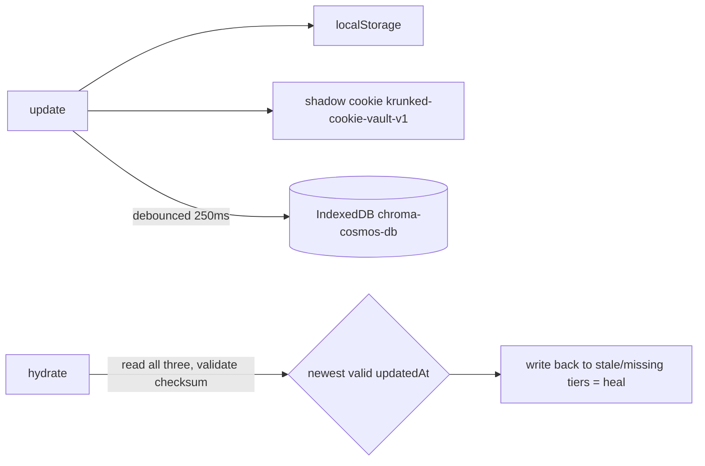

# ARCHITECTURE — Chroma Cosmos: Violet's Living Sketchbook

Zero-backend PWA. Static build (`vite build`, `base: './'`) deployed to GitHub Pages at
`https://krunked-fpv.github.io/chroma-cosmos/`. All state is client-side.

## 1. Module map and dependency rule

```
src/contracts/   types + `as const` data only (no logic, no imports outside contracts)
src/art/         ArtPort        procedural pixel-art + region rasterizer
src/scenes/      scene generators used by src/art
src/renderer/    RendererPort   PixiJS v8 / WebGL2 4-layer compositor
src/shaders/     GLSL ES 3.00 sources as TS string modules
src/simulation/  SimulationPort coverage, awakening, causality, actors, relics
src/roguelike/   RunManagerPort 5-chapter run, doors, drafting
src/audio/       AudioPort      Web Audio synth (F-Lydian)
src/vault/       VaultPort      localStorage + IndexedDB + shadow cookie
src/export/      KeepsakePort   PNG postcard + JSON download
src/ui/          UiPort         sketchbook DOM chrome, hub, modals, pointer input
src/main.ts      composition root (only file that imports module factories)
```

Rule: every `src/<module>/` imports ONLY from `src/contracts/` and its own directory. `src/main.ts` is the only
place that wires modules together, strictly via the interfaces in `src/contracts/`. No circular dependencies.

Factories: `createArt`, `createRenderer`, `createSimulation`, `createRunManager`, `createAudio`,
`createVault(backends?)`, `createKeepsake`, `createUi(root)`.

## 2. Four-layer GPU compositing topology

PixiJS v8 `Application`: `preference:'webgl'`, `preferWebGLVersion:2`, `antialias:false`, `autoDensity:true`,
`resolution = min(devicePixelRatio, 2)` (adaptive downshift to 1.5 / 1 when median frame > 18 ms for 2 s),
background `#120d2b`. If WebGL2 is unavailable a friendly DOM message is shown.

Canvas sizing: canvas fills `ui.canvasHost` (16:9). `s = floor(min(hostW*dpr/480, hostH*dpr/270))`;
if `s >= 2` use an exact integer scale centred, else a fractional aspect-locked scale. All pixel-art lookups use
NEAREST + `texelFetch`.

### Data textures (`BufferImageSource`, `format:'rgba8unorm'`, `scaleMode:'nearest'`, `alphaMode:'no-premultiply-alpha'`, `source.update()` after mutation)
| Texture | Size | Contents |
|---|---|---|
| `uRegionTex` | 480x270 | R regionMap id, G baseRegionMap id (actors removed), B actorSlot (0 none, 1..15 incl. ink of actor resting pose), A 255. Uploaded once per page. |
| `uActorTex` | 480x270 | R region id (0 ink), A 255 where an actor/FX pixel exists else 0. CPU-blitted each frame from sprite frames + FX pixels. |
| `uRegionStateTex` | 256x2 | bytes straight from `SimView.regionState` (layout in SPEC §REGION_STATE). |
| `uAllowedTex` | 256x1 | 1 = region id allowed for the current stamp batch. |
| `uStrokeTex` | 1920x1080 ×2 | ping-pong RenderTextures, RGBA8 LINEAR: R coverage, G materialId/255 (texelFetch), B/A flow dx/dy (0.5-centred). |

### Layers (composite pass is full-screen at native resolution)
- **Layer 0 — Paper & Parallax Space.** Region 1..254 uncoloured: warm cream cotton paper tooth + faint compass/grid
  markings. Region 255: 3 parallax star planes, Sleepy Hush mist `#6b5b8a` with alpha `(1-pageAwakening)*0.55` as
  drifting wisps that part as the page awakens, plus Free-Starlight doodle strokes.
- **Layer 1 — Dual-Buffer Stay-In-The-Lines masking.** CPU: `Uint8Array(480*270)` region map drives touch-lock in
  simulation. GPU: the stamp pass reads the previous stroke RT plus `uAllowedTex` and writes coverage only where the
  NEAREST-sampled internal region id is allowed. Output = max coverage; material/flow replaced where the new stamp dominates.
  One full-RT quad per batch, ≤64 stamps per batch.
- **Layer 2 — GLSL Pigment Materials.** One unified fragment shader branching on `program` (1..10) for the 12 material
  ids (24K Solar Flare = program 4 + gold palette; Aurora Sherbet = program 1 + sherbet palette). Smooth gradients
  stay razor-sharp inside integer ink borders because the region id is sampled NEAREST.
- **Layer 3 — Ink, Sel-Out, Living Sprites.** Ink `#231942` while uncompleted. A completed region flashes golden-white
  then ink pixels adjacent to it become sel-out (darkened pigment colour via 4-neighbour id + completion flags).
  Actors become multi-frame sprites carrying their painted GLSL coat. Particles: `ParticleContainer` of a 3×3 pixel star,
  positions snapped to internal pixels × scale.

Id resolution per pixel: if `uActorTex.a>0` use its id; else if B>0 and bit B of `uLiveSlots` is set use G (base map);
else R. Id decode `int(floor(texelFetch(t,p,0).r*255.0+0.5))`.

Id classes: 0 ink; 1..211 colourable (canonical 1..31, dynamic 32..211); 212..233 system (fixed material);
234..254 ghosts (hidden until revealed or inside the UV flashlight); 255 sky.

### Page-turn curl
Capture the old composite into a pooled RenderTexture, load the next page, run the curl shader for `PAGE_TURN_MS`
(cylinder fold, cream paper back side), release the RT to the pool.

### Lifecycle
All RenderTextures come from a pool with explicit `destroy(true)` on unload; `stats()` exposes live counts.
`webglcontextlost` → `preventDefault`; on restore rebuild textures from CPU state and reseed the stroke RT by stamping
completed regions.

## 3. CPU / GPU Region-ID synchronisation
1. `art.compilePage` produces `CompiledPage` (regionMap, baseRegionMap, actorSlotMap, totals, metas).
2. `renderer.loadPage` uploads `uRegionTex`; `simulation.loadPage` keeps the same map as a CPU mirror and builds a CSR
   pixel index per region.
3. Pointer → `ui` converts client→internal via `renderer.clientToInternal` → `simulation.gesture`.
4. Simulation locks `lockedRegionId` on start, emits `GpuStampBatch` (allowed ids + stamps) and updates
   `paintedMask`/`regionPaintedPixels` in O(brushArea). Coverage % is O(1): `regionPaintedPixels[id] / regionTotalPixels[id]`.
5. Renderer drains batches into the stroke RT and uploads `SimView.regionState` when dirty.

Frame loop (in `main.ts`): `sim.update(dt)` → route `sim.drainEvents()` to audio/vault/ui → `renderer.render({view, stampBatches, ...})` → telemetry ring buffer.

## 4. Simulation
Awakening stages per region: 1 (1–25%) Stirring, 2 (26–65%) Half-Awake, 3 (66–92%) Building Magic,
4 (≥93%) Auto-Bloom: exactly-once radial Chromatic Ripple fills the remaining pixels, flash flag, gems, causality
(`CAUSALITY_MATRIX`), actor awakening. No timers, no fail states.

## 5. F-Lydian audio graph
```
voices (brush noise, stems, plucks, chimes) → master gain(level) → DynamicsCompressor (limiter) → destination
```
Brush: looped pink-noise buffer → filter per family (grain: lowpass+crackle, sweep: bandpass with LFO, bell: sine grains).
96-BPM look-ahead scheduler (25 ms tick, 100 ms horizon) for stems: pad, marimba, harp, celesta.
Scale: F4 G4 A4 B4 C5 D5 E5 + octaves. Every transient node disconnects on `onended`.
AudioContext is created/resumed on the first pointerdown. Audio is a safe no-op without a context.

## 6. Vault tiers (`krunked-cookie-vault-v1`)

- Hydration picks the newest valid tier, then writes it back to any missing/stale tier and reports `healed`.
- `healCheck()` regenerates a missing cookie/localStorage from memory (called on focus/visibility and after updates).
- IDB uses `onversionchange → db.close()` so external `deleteDatabase` is never blocked.
- Cookie: `base64url(JSON) + '.' + fnv1a32hex`, `SameSite=Lax; path=/; max-age=31536000`, < 1500 chars.
- Portable JSON export/import: `{format:'chroma-cosmos-vault', version:1, exportedAt, vault, storybooks}`.

## 7. PWA / Service Worker
- `public/manifest.json`, `public/sw.js`, 3 raster PNG icons generated by `scripts/generate-pwa-icons.mjs`.
- All URLs relative (`./`). SW registered from `main.ts` in production only with `{ scope: './' }`.
- `sw.js`: `CACHE_VERSION = 'chroma-cosmos-v1'` (== `src/contracts/constants.ts`); install precache + skipWaiting;
  activate deletes older `chroma-cosmos-*` caches + clients.claim; fetch is network-first for same-origin GET with
  cache fallback (navigations fall back to `./index.html`).
- `beforeinstallprompt` → dismissible "Install Sketchbook" star badge when not in standalone display mode.
- CI: `.github/workflows/deploy-pages.yml` (Node 22, typecheck + test + build, upload-pages-artifact, deploy-pages).

## 8. File ownership
| Owner | Files |
|---|---|
| Clara Vance | ARCHITECTURE.md, SPEC.md, HANDOFF.md, package.json, tsconfig.json, vite.config.ts, .gitignore, src/contracts/**, src/main.ts |
| Julian Kwan | src/renderer/**, src/shaders/**, tests/unit/renderer/** |
| Nadia Solis | src/art/**, src/scenes/**, tests/unit/art/** |
| Marcus Thorne | src/simulation/**, src/roguelike/**, tests/unit/simulation/**, tests/unit/roguelike/** |
| Sora Takahashi | src/audio/**, tests/unit/audio/** |
| Elena Rostova | src/vault/**, src/export/**, tests/unit/vault/**, tests/unit/export/** |
| Mateo Silva | index.html, src/styles/**, src/ui/**, tests/unit/ui/** |
| Tessa Lindqvist | public/**, scripts/generate-pwa-icons.mjs, .github/workflows/deploy-pages.yml, tests/unit/pwa/** |
| Devon Brooks | tests/redteam/**, tests/e2e/** |

## 9. QA hook (`window.__chroma`)
Always: `telemetry()`, `resetTelemetry()`, `stats()`. With `?qa=1`: `qa.regions()`, `qa.clientPointOf(id)`,
`qa.paintRegion(id, materialId)`, `qa.poke(kind)`, `qa.startRun(seed)`, `qa.completePage()`, `qa.mode()`.
